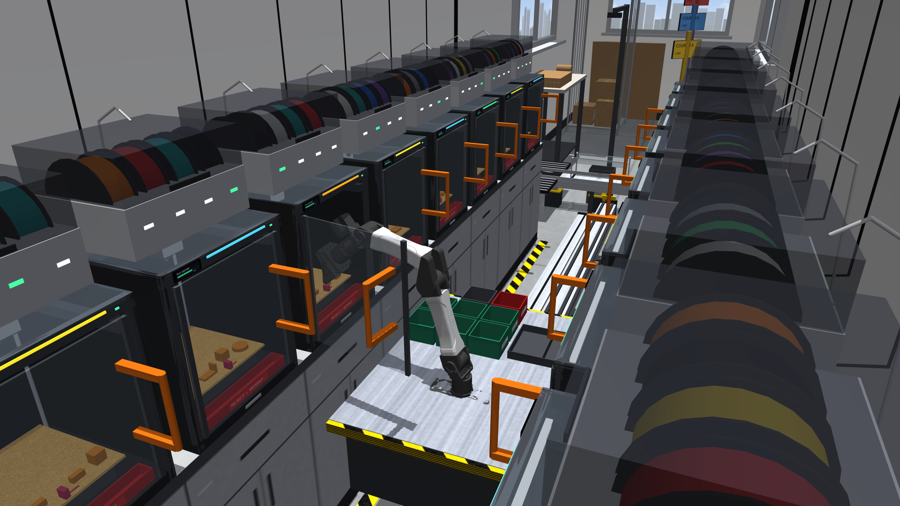
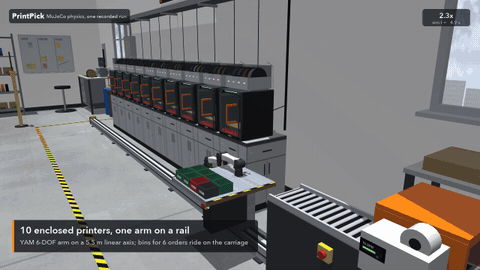
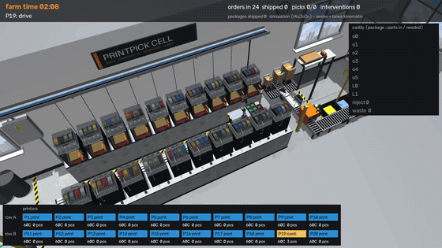
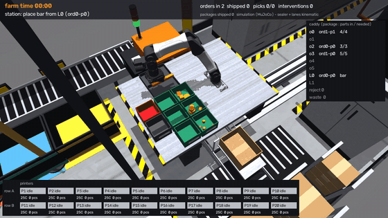
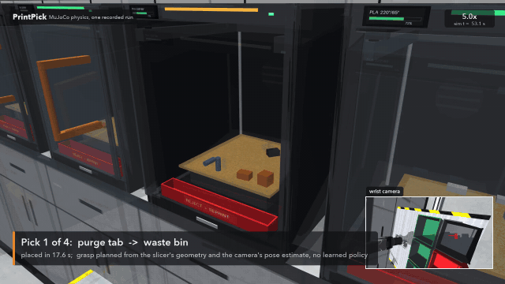
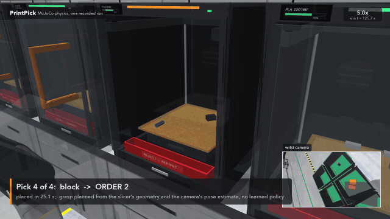
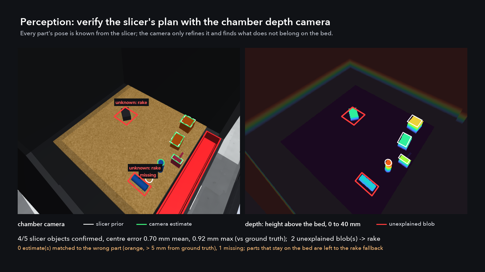
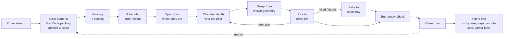
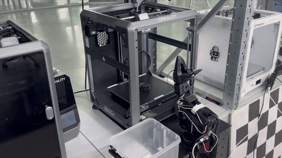

# PrintPick: a robot that keeps a 3D-print farm running

[](https://github.com/msannikov03/printfarm-sim/actions/workflows/ci.yml)


[](LICENSE)



When a print finishes at 3 a.m., the printer sits idle until someone opens the door, takes the parts off the bed
and starts the next job. PrintPick is a physics simulation of a cell where a robot does that job. One 6-DoF arm on
a linear rail tends two facing rows of ten enclosed printers (Bambu P1S-class, 256 mm bed): the rail runs down the
middle of the aisle, and the arm turns between the rows. For each finished printer it:

- **opens the glass door** by a plain D-handle with one whole-body swing of the arm and the rail. The arm then
  folds low enough to drive under the open doors (only when one is in the way: it drives upright otherwise);
- **looks at the bed** with the printer's chamber camera and corrects the slicer's part poses with depth;
- **plans a grasp for every part from the slicer's own geometry**: no learned policy, no training data;
- **sorts parts by package**: small parts into the package's tote on its carriage, large ones into a tray slot, and
  **rakes** anything it cannot pick (a tipped part, failed-print debris) into a reject tray, so a failed pick does not
  have to stop the printer;
- **closes the door** and moves on. At the packing station every finished package goes **from bed to box**: the box of
  the right size comes to the robot, large parts are placed in it, the tote's trap door drops the small parts in, and
  the sealed box rides to its carrier lane.

A discrete-event model of the whole farm then runs a simulated week on the timings measured in physics. Its answer:
printer utilisation goes from **48 %** with an operator on day shifts to **87 %** with the robot,
and order lead time p90 drops from **99.9 h** to **10.2 h**.



**Watch / explore.** The whole 20-printer cell at 8x, filmed by an automatic camera director (`farm/director.py`
picks a ray-cast, unoccluded angle for each unload, door, drive and station hand-off):



To orbit, zoom and pause the running farm yourself: `PYTHONPATH=. .venv/bin/mjpython scripts/view_farm.py`
(`--unload 5` for one printer; `mjpython` ships with MuJoCo and is needed on macOS, plain `python` elsewhere).

## Results

All numbers come from scripts in this repository. [docs/results.md](docs/results.md) lists the command behind each one.

**The cell: two facing rows of 10** (the default; `PRINTFARM_LAYOUT=one_row` gives the original single row of 10).
Facing rows halve the rail per printer, and with the bins beside the arm instead of behind it a pick takes less arm
travel. 20 random plates per row, realistic sensors and actuation:

| Printer | Parts placed | Doors open / closed | Printers blocked | Sim time per pick |
|---|---|---|---|---|
| Row A (printer 5) | 100/100 (100.0 %) | 20/20 / 20/20 | 0 | 17.5 s |
| Row B (printer 15, facing) | 99/100 (99.0 %) | 20/20 / 20/20 | 0 | 21.9 s |

The [layout study](docs/layout.md) puts the knee at about 50 printers per arm: with 20 the arm is busy only
31 % of the time, so the cell has room for slower parts, more failures or more printers.

**Sensors from ideal to harsh** (40 random plates per batch, measured on the single-row cell). Picking carries over
to the two-row cell (same printer, arm, door and perception; checked above). Debris clearing is harder there: the
two-row beds sit 12 cm farther from the rail, so the robot pushes far debris off the side edge of the bed with the
carriage; in two-row fault batches a lump stayed on 3 of 40 beds (the camera flagged every one, see
[sim2real](docs/sim2real.md)).

| Scenario | Parts placed | Doors open / closed | Beds left clear | Sim time per pick |
|---|---|---|---|---|
| Ideal sensors | 195/195 (100.0 %) | 40/40 / 40/40 | 40/40 | 23.5 s |
| Realistic sensors and actuation: depth noise, calibration errors, encoder noise, latency | 194/195 (99.5 %) | 40/40 / 40/40 | 40/40 | 23.6 s |
| Harsh sensors and actuation (2x depth noise, about 3x calibration and actuation errors) | 149/195 (76.4 %) | 40/40 / 37/40 | 33/40 | 24.6 s |
| Realistic + faults: one tipped part + one debris lump per bed | 162/195 (83.1 %) | 40/40 / 40/40 | 40/40 | 23.5 s |

"Placed" is ground truth (the part really is in its order bin); the robot itself only uses its sensors to decide.
In the fault batch every part that could not go to its order bin was cleared off the bed (raked into the reject
tray, picked into the reject bin or pushed off the side edge: **100 %** of them), so those printers kept
printing instead of waiting for a person, and no debris lump stayed on a bed.

**Perception**: part centre error after refining the slicer prior with chamber-camera depth:

| Depth input | Centre error, mean / p95 | Yaw error, mean | Parts found |
|---|---|---|---|
| Perfect rendered depth | 0.20 / 0.54 mm | 0.09° | 100 % |
| Realistic depth (see [sim2real](docs/sim2real.md)) | 0.51 / 1.04 mm | 0.47° | 100 % |

**Fleet, 20 printers (2 x 10), 7 days, 5 seeds** (DES with the timings measured on both rows; the same demand per
printer for the robot and the human):

| | Robot cell, 24/7 | Human operator, Mon-Fri 9-18, hourly rounds |
|---|---|---|
| Printer utilisation | 87 % | 48 % |
| Parts per day | 557 | 289 |
| Order lead time, p50 / p90 | 6.0 h / 10.2 h | 61.6 h / 99.9 h |
| Robot busy | 31 % | n/a |

With large parts in the order mix (16 % of parts) at the same print load, the robot cell makes
403 parts per day against 207, with order lead time p50 / p90 5.8 h / 10.8 h against
69.6 h / 106.8 h.

The robot is busy only 31 % of the time, so the real constraint is reliability, not speed. Without the
rake, every failed pick blocks its printer until the next shift, and the robot cell's output falls to the human
baseline at about **7 %** failures per part. With the rake (failed parts are cleared and reprinted) it
still out-produces the human at 20 % failures per part (23.3 vs 16.1 parts per printer per day). Layout options (rows, printers per arm) are compared in [docs/layout.md](docs/layout.md).

**Whole cell, physics end to end** (`scripts/run_farm.py --backlog 20`, 20 printers, realistic sensors, large parts
in the order mix, a morning backlog of 20 orders so that every printer runs): 30 plates on all 20
printers in 5.7 farm-hours, 117/120 picks placed (missed parts are reprinted automatically), doors
30/30 opened and 30/30 closed, 29/29 boxes sealed complete, order lead time p50 / p90 3.3 h / 5.5 h (orders shipped within
the run, backlog orders counted from the start); operator interventions: 0.

**From bed to box** ([docs/station.md](docs/station.md)). An order ships as one or more packages: at most
6 small parts, which ride in one tote on the carriage, plus at most two large parts (housing, plate,
bar), which ride in a tray slot. The packer picks the smallest of three boxes that the arm can actually fill, with
finger room measured in physics. At the station the robot requests that box; the arm sets the large parts on its
floor; a lift raises it under the tote; the trap door opens; a station depth camera confirms the tote is empty; and the
box goes to the sealer and its carrier lane. One box and one tote at a time, so packages never mix.



| | Result |
|---|---|
| Large parts, bed to tray (20 plates per row, realistic) | 40/40 placed (row A 20/20, row B 20/20) |
| Station bench (realistic): packages boxed, parts in the right box | 53/53 boxes complete, 151 parts, 0 missing, 0 operator calls, 0 robot-station contacts |
| Robot time at the station per package (measured) | 20 s (sd 7 s, n = 53) |
| Partial packages handed to an operator, per week (DES) | 1.2 (small parts only; 39 with first-in-first-out printing), 1.0 with large parts in the mix |

The last row is a scheduling result: printing a package's parts on as few plates as possible keeps its tote from
waiting hours for a fragment printed elsewhere (`fleet/queue_policy.py`).

| Pick into an order bin | Rake into the reject tray | What the chamber camera sees |
|---|---|---|
|  |  |  |

## How it works



**The slicer is the prior.** The slicer already knows every part's SKU, position, yaw and height, and writes them into
the G-code as labelled objects (`EXCLUDE_OBJECT_DEFINE`). The robot plans its grasps from that geometry. The chamber
camera only refines and verifies: it back-projects depth to bed coordinates, fits each part's top face near its prior
footprint, flags missing parts, and reports any raised blob that no slicer object explains as debris. The design runs
the other way as well: a grasp-feasibility map of the bed (`plan/bedmap.py`) goes back to the packer, so the slicer
only places parts where the robot can pick them, with gaps wide enough for a jaw.

**Doors with an everyday handle.** No door actuator and no docking fixture: the only change to the printer is a large
D-handle on the glass, where a person would pull. The arm grasps it and opens the door in one continuous swing that
moves the arm and the rail together, planned so that every sample of the hinge arc has a collision-free IK
solution. The jaws cage the bar 25 mm deep and the door moves only through contact forces (no rigid lock); the
measured coupling loads give a grip-force spec for a real gripper. The arm base sits low on the carriage, so a folded
arm passes under open doors. Details: [docs/door.md](docs/door.md).

**Sensors, not simulator truth.** The robot never reads the simulator's state to decide anything. Its planning scene
is built from what the chamber camera saw (each part padded by its estimated uncertainty, unexplained blobs as
obstacles); the door angle comes from arm kinematics while it holds the handle, plus a reed switch at the latch;
"did it lift / did it drop / is it still on the finger" come from the gripper encoder and a wrist camera; and a
wrist-camera alignment before each grasp cancels the arm's own calibration error. Ground truth is only used to score
the result. Details: [docs/sim2real.md](docs/sim2real.md).

**Grasping without learning.** Jaws close across the narrow side of each footprint. The planner searches the
approach tilt (0 to 90°, tilting into the printer first), the grasp height, the jaw direction and the carriage
position, then runs RRT-Connect with a padded collision model. Once the part is lifted, it counts as part of the robot in every collision check.
Before each pick the camera re-scans the bed, so a part nudged by a neighbouring pick is found where it is now. After
release, a check confirms the part actually fell. If it is stuck to a finger, the wrist shakes it off.

**A failure should not stop the printer.** Anything that cannot be picked (a tipped part, failed-print debris) is
cleared from the bed: picked as a box into the caddy's reject bin when its outline allows it, otherwise pushed off the
front of the bed into a per-printer reject tray (jaws closed, fingertips 3 mm above the bed, one stroke toward the
door), or off the nearer side edge as a last resort. The DES counts these parts as reprints, not as stops.

**Measured, then scaled.** `scripts/eval_unload.py` runs batches of random plates in physics.
`scripts/make_timings.py` turns the per-part results into door times, pick times and failure rates. `fleet/des.py`
then simulates a week of orders, printing, cooling, scheduling and caddy logistics for the robot policies and a human
baseline. Architecture and data contracts: [docs/architecture.md](docs/architecture.md).

## Sim vs real: what is modelled and what is not

| | In this simulation | On real hardware |
|---|---|---|
| Arm, rail, gripper, part contacts, door hinge | MuJoCo rigid-body physics; the YAM model is the vendor's | rail dynamics, payload limits and finger compliance are idealised |
| Depth camera | D435-class stereo depth model: range-dependent noise, dropouts, sheen, flying pixels, calibration error and camera failures (realistic and harsh presets) | a real chamber camera adds noise, missing pixels and reflections from shiny PLA |
| Camera-to-bed calibration | persistent extrinsic and intrinsic error drawn per camera; corrected online by a bed-plane fit and the build-plate outline | fitted per printer (`real/calib.py`) |
| Bed adhesion | a weld that releases once the bed cools below a threshold | a cooled part can still stay stuck (not modelled yet) |
| Door latch, handle grip | magnetic catch (pull ~ 1/(1+g)^2) and a jaw grasp around the handle bar, contact forces only | the catch force must be measured (spec: <= 18 N for a squeeze hold, else non-backdrivable jaws) |
| Robot's own state | encoder noise, joint-zero and link calibration error, backlash, latency (presets) | measured per arm at commissioning |
| Print time, cooling, order rates | assumptions, all listed in `fleet/des.py` `Params` | measure per farm |
| Packing station | trap-door totes, the box contents, the large-part place and the station depth camera are physics; the boxes ride on prescribed joints, and from sealing on (sealer, sorter, lanes) it is kinematic | not built; the totes, the tray and the camera check are the parts a real cell would need first |

The full noise and failure model, and how the planners cope with it, is in [docs/sim2real.md](docs/sim2real.md).

## Quick start

```bash
git clone https://github.com/msannikov03/printfarm-sim && cd printfarm-sim
python3.11 -m venv .venv && .venv/bin/pip install -r requirements-dev.txt
.venv/bin/python -m pytest                                   # unit tests (fleet, slicer, printer backends, SO-101)

export PYTHONPATH=.
.venv/bin/python scripts/test_door.py 4                       # open + close the door of printer 5 (~5 s)
.venv/bin/python scripts/test_drop.py gear                    # one pick into a bin (~10 s)
.venv/bin/python scripts/test_rake.py cube 150 80             # camera blob -> rake into the reject tray
.venv/bin/python scripts/test_perception.py 10                # camera vs slicer-prior accuracy
.venv/bin/python scripts/eval_unload.py --n 40 --procs 8      # batch of random plates -> runs/eval/
.venv/bin/python scripts/eval_unload.py --n 40 --faults --out runs/eval_faults
.venv/bin/python scripts/make_timings.py runs/eval && .venv/bin/python -m fleet.des --compare --days 7
.venv/bin/python -m report.plots                              # Gantt / KPI / economics plots -> runs/plots/
.venv/bin/python scripts/run_farm.py --hours 8 --plates 12 --video --speed 8   # whole cell -> runs/farm/
.venv/bin/python scripts/run_farm.py --hours 16 --plates 30 --backlog 20 --video # + a morning order backlog: all 20 printers busy
```

Add `--video` to the `test_*` scripts to write an mp4 to `runs/`. On a headless Linux box, set `MUJOCO_GL=egl`
(GPU) or `MUJOCO_GL=osmesa`. `scripts/remote.sh run HOST DIR <script> ...` syncs the checkout to a remote machine
and runs a script there. The YAM arm model is vendored in `assets/yam`. Lab textures are generated on first use.

## Real hardware

[`real/`](real/README.md) runs the same idea against a real **Creality** printer and a low-cost **SO-101** arm:

1. read the printer state: stock Creality OS websocket (K1 / K2 / Ender-3 V3 family), Moonraker, OctoPrint or Marlin
   over USB;
2. wait until the print is done and the bed is cool;
3. get the G-code and extract every part from it (labelled objects, or clustering of the extrusion moves when the
   slicer did not label them);
4. map bed millimetres into the arm frame with a touch-off calibration (Kabsch fit);
5. solve IK on the official SO-101 MuJoCo model, render a preview, then move above each part. Dry-run by default;
   live mode asks for confirmation before every motion.

The arm can hang off a Raspberry Pi: `real/feetech.py` drives the STS3215 servo bus directly (pyserial only, no
LeRobot or torch on the Pi), `real/arm_server.py` runs the motion loop on the Pi with joint limits, a bed keep-out and
a watchdog, and the laptop plans and sends targets over the network (`--arm remote://<pi>:8765`). A step-by-step
bring-up guide is in [real/DEMO_DAY.md](real/DEMO_DAY.md).

**Real 3D models**: STL / 3MF files go through a real slicer (BambuStudio's command line), the G-code parser and into
the simulated cell as mesh parts; how the robot unloads them is in [docs/real_models.md](docs/real_models.md).

Everything in `real/` is tested against mock printers (`real/tests`, no hardware needed):
`python -m real.run_demo --mock --dry-run --sim-preview` rehearses the whole run.

**First real pick** (lab, 28 Oct 2026): the SO-101 reaches into a Creality printer, takes a printed part off the bed and
drops it into a bin (2× speed).



## Repository map

| Path | What |
|---|---|
| `farm/` | layout constants, MJCF scene builder, runtime world (adhesion, latches), lab dressing, video tools |
| `plan/` | IK with the rail as a 7th axis, RRT-Connect, door primitive, grasp synthesis and unloading, rake fallback, bed map, packing-station skills |
| `perceive/` | chamber-camera depth vs the slicer prior: pose refinement, missing parts, debris, bed-empty check |
| `jobs/` | order stream, package planner (order -> packages -> box size), slicer stand-in (MaxRects, labelled G-code), G-code parser |
| `fleet/` | package-aware caddy allocator, print-queue policy, scheduling policies, discrete-event simulation |
| `sim/` | the whole cell loop (farm clock + physics robot actions) |
| `report/` | plots from the DES output |
| `scripts/` | runnable experiments: single-skill tests, batch evaluation, layout studies, rendering |
| `real/` | hardware toolkit: printer backends, G-code parts, calibration, SO-101 kinematics and driver |
| `tests/`, `real/tests/` | unit tests (run in CI) |
| `docs/` | [architecture](docs/architecture.md), [results](docs/results.md), [sim2real](docs/sim2real.md), [door](docs/door.md), [perception](docs/perception.md), [layout](docs/layout.md), [station](docs/station.md), [real models](docs/real_models.md) |

## Roadmap

- Debris clearing in the two-row cell: lumps in the back corners are out of reach of any low finger pose (3 of 40
  fault plates kept a lump), and pushed lumps end on the chamber floor; a dedicated sweep tool on the carriage.
- Large parts on dense plates: small parts pushed deep behind a large part have marginal grasps (about 82 % on
  plates packed to 8 h, 100 % at the farm's 3 h cap); an unpickable housing lying into the printer may need a person.
- Grow toward the layout study's 2 x 20 printers per arm (the arm is busy about a quarter of the week at 2 x 10).
- Calibrate the depth-noise model against a real chamber camera and close the loop on the real printer.
- Door opening on a real enclosure: measure the catch force and the handle grip on hardware.
- Bed-plate swap as an alternative to unloading in place, compared in the DES.
- Force-aware release of stuck parts (flex the plate or scrape) instead of relying on the cooled bed.

## Team

- **Mikhail Sannikov** ([@msannikov03](https://github.com/msannikov03)): process owner
- **Ilya Mikhalchuk** ([@miilv](https://github.com/miilv)): software
- **Petr Kovalev**: hardware

## License and acknowledgements

MIT, see [LICENSE](LICENSE). Third-party models keep their own licenses; see
[THIRD_PARTY_NOTICES.md](THIRD_PARTY_NOTICES.md).

- [MuJoCo](https://github.com/google-deepmind/mujoco) for the physics and rendering.
- [MuJoCo Menagerie](https://github.com/google-deepmind/mujoco_menagerie) for the I2RT YAM model (MIT, vendored in
  `assets/yam`) and the RobotStudio SO-101 model (Apache-2.0, fetched by `real/fetch_assets.sh`).
- [LeRobot](https://github.com/huggingface/lerobot) for the SO-101 calibration conventions and motor bus.
