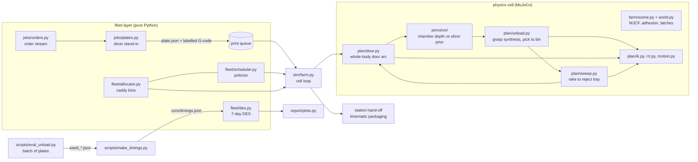

# Architecture

The repository has three layers that share one set of constants (`farm/catalog.py`) and a few JSON contracts:

1. **Physics cell** (MuJoCo): the printers, the robot, its planners and the chamber camera. Every robot action is
   simulated with contacts.
2. **Fleet layer** (pure Python): orders, the slicer stand-in, the caddy allocator, scheduling policies and a
   week-long discrete-event model that uses timings measured in layer 1.
3. **Hardware toolkit** (`real/`): the same pipeline (printer done, then G-code, then parts, then arm) against a
   real Creality printer and an SO-101 arm. It is self-contained and does not import the simulation packages.



## Modules

| Module | Role | Notes |
|---|---|---|
| `farm/catalog.py` | layout, printer and door geometry, SKUs, frame transforms | pure Python, imported by both layers |
| `farm/scene.py` | builds the MJCF: rail + carriage + YAM, 10 enclosures with hinged doors, beds, reject trays, caddy, station | YAM from `assets/yam` (vendored) |
| `farm/lab.py` | visual dressing only: room, lights, printer details, generated textures | must not change physics counts (`scripts/preview_lab.py` checks) |
| `farm/world.py` | runtime wrapper: part pool, spawn/park, adhesion welds, door latch and coupler, contact queries | |
| `plan/ik.py` | damped-least-squares IK on a scratch `MjData`, rail as an optional 7th axis, padded collision model, held-part attachment | planning never touches the live sim |
| `plan/rrt.py` | RRT-Connect in joint space (optionally + rail) with shortcutting | |
| `plan/motion.py` | executor: joint and Cartesian moves on position actuators, gripper, frame recording | |
| `plan/door.py` | door primitive: grasp the D-handle, one continuous whole-body arc (arm + rail), regrasp fallback, transfers between poses | see [door.md](door.md) |
| `plan/unload.py` | per-part grasp synthesis from slicer geometry (+ camera estimate), pick, release check, drop into the caddy; `unload_parts()` re-scans before each pick | |
| `plan/sweep.py` | fallback: camera blobs, then a rake stroke into the per-printer reject tray | |
| `plan/bedmap.py`, `plan/reach.py` | grasp-feasibility map of the bed (fed back to the slicer as a keep-in mask), reach studies | |
| `perceive/` | chamber-camera depth, back-projection to bed mm, slicer-prior refinement, missing-part and debris detection, bed-empty check | see [perception.md](perception.md) |
| `jobs/` | order stream, MaxRects slicer stand-in with labelled-object G-code, G-code parser | |
| `fleet/` | caddy allocator, scheduler policies, discrete-event simulation | |
| `sim/farm.py` | the whole cell: farm clock, printing and cooling timers, robot actions in physics, station, packaging | |
| `report/plots.py` | Gantt chart, KPI comparison and economics plots from the DES output | |
| `real/` | hardware toolkit: printer backends, G-code part extraction, calibration, SO-101 kinematics and driver | see [real/README.md](../real/README.md) |

## Frames and units

- **World** (m): the rail runs along +x at y = 0; row A stands on +y (doors face -y), row B mirrored on -y
  (`C.printer_frame(i)` -> (x, side)); the one-row cell has row A only.
- **Printer local** (m): origin on the door plane at the printer centre line, z = 0 at the enclosure floor;
  x to the right as seen from the aisle, y into the printer. Hinge on the left.
- **Bed** (mm): origin at the bed's front-left corner seen from the aisle, x right, y into the printer,
  z up from the bed surface. This is the slicer frame. The camera and the planners convert with
  `catalog.bed_mm_to_world()`.
- **Grasp frame**: z = approach direction (out of the gripper), y = finger closing direction.

## Contracts

### `plate.json`: slicer stand-in, consumed by the cell and the DES

```json
{"plate_id": "P0007", "printer": 3, "print_time_s": 5400.0, "bed_mm": [256, 256],
 "purge_tab": {"center_mm": [128.0, 13.0], "dims_mm": [10.0, 20.0, 20.0]},
 "objects": [{"name": "o12_knob_1", "order_id": "o12", "sku": "knob",
              "center_mm": [80.0, 120.0], "yaw_deg": 0.0, "height_mm": 16.0,
              "footprint_mm": [30.0, 30.0], "polygon_mm": [[65,105],[95,105],[95,135],[65,135]]}]}
```

The G-code next to it carries the same objects as Klipper `EXCLUDE_OBJECT_DEFINE NAME=... CENTER=x,y POLYGON=[...]`
blocks, the format Klipper-flavoured slicers (Orca, Creality Print, PrusaSlicer) write when object labelling is on.
`jobs/gcode_prior.py` and `real/gcode_objects.py` both parse it; `real/tests/test_gcode_objects.py` checks that they
agree on generated plates (`python -m jobs.plates` writes them to `runs/plates`).

### Per-part outcomes: `unload_parts()` and the batch evaluator

| outcome | meaning | blocks the printer? |
|---|---|---|
| `placed` | part is in its bin (or the purge tab in the waste bin) | no |
| `swept` | raked into the reject tray, to be reprinted | no |
| `no_grasp`, `insert_blocked`, `not_lifted`, `slipped`, `missed_bin`, `missing` | failure; the part is `blocking` only if it is still on the bed after the rake rounds | if still on the bed |

`scripts/eval_unload.py` writes one `seed_XXX.json` per plate (`parts[]` with `outcome`, `s`, `blocking`; `door_open`,
`door_close`, `bed_empty_after`, `faults`) and a `summary.json` with counts, the placed rate and the time per part.

### `runs/timings.json`: measured in physics, consumed by the DES

`scripts/make_timings.py runs/eval` writes it. If the file is missing, `fleet/des.py` falls back to its built-in
defaults.

| key | source |
|---|---|
| `door_open_s`, `door_close_s` | mean simulated door time over the batch |
| `pick_place_s_mean`, `pick_place_s_std`, `purge_tab_s` | per-part simulated times |
| `p_intervention_per_part` | parts still on the bed after the rake rounds (`blocking`) / parts |
| `p_reprint_per_part` | parts neither placed nor blocking (raked into the tray, dropped off the bed) / parts |
| `p_success_first_try` | placed / parts |
| `p_blocked_plate`, `door_ok_rate`, `rake_s` | plates left blocked, door success rate, mean rake time |
| `scan_s`, `bed_check_s`, `station_handoff_s`, `retry_s`, `rail_speed_mps` | fixed assumptions, listed in the file |

### Caddy allocator (`fleet/allocator.py`)

An order ships as one or more packages (`jobs/packaging.py plan_packages`: at most 6 small parts in one tote, at most 2
large parts, box S/M/L). A tote holds the small parts of one package; a large-part tray slot (two-row cell) holds one
large part. Packages never mix. The full API is in the module docstring.

```python
alloc = CaddyAllocator(order_book)   # {order_id: {"parts": [...], "packages": (Package, ...), "carrier": c}}
slot = alloc.slot_for(part_name)     # "o0".."o5" tote of its package | "L0"/"L1" tray slot | "reject" | "waste"
                                     # | None (no free tote / tray slot: visit the station)
alloc.placed(part_name, slot)        # -> package_id when that package is now complete
alloc.handoff_ready()                # -> [ReadyPackage(package, tote, large_slots, shelf)], oldest order first
alloc.handed_off(package_id)         # frees its tote + tray slots -> order_id once all its packages have shipped
alloc.park(slot)                     # deadlock breaker: an incomplete package's tote / tray slot -> consolidation shelf
```

## What is simulated, and how faithfully

| Thing | How it is modelled |
|---|---|
| arm, rail, gripper, parts, door hinge, end stop | MuJoCo rigid-body dynamics with contacts and friction |
| door latch, handle coupler | equality constraints switched at runtime: a magnet latch and a rigid lock while the gripper holds the handle |
| bed adhesion | a weld per part, released once the bed has cooled below the release temperature |
| chamber camera | MuJoCo depth render. The sensor-noise and failure model is described in [sim2real.md](sim2real.md) |
| print and cooling time, order arrivals | timers and seeded random processes (assumptions, listed in `fleet/des.py` `Params`) |
| packaging line, carrier lanes | kinematic animation |
