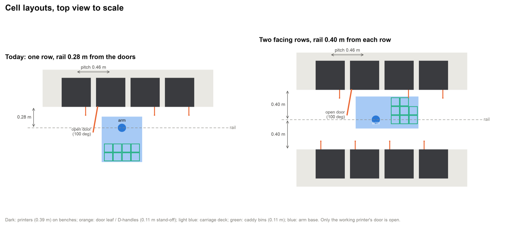
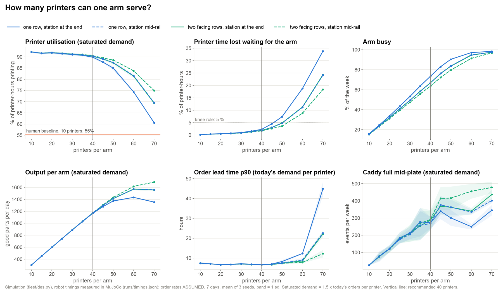
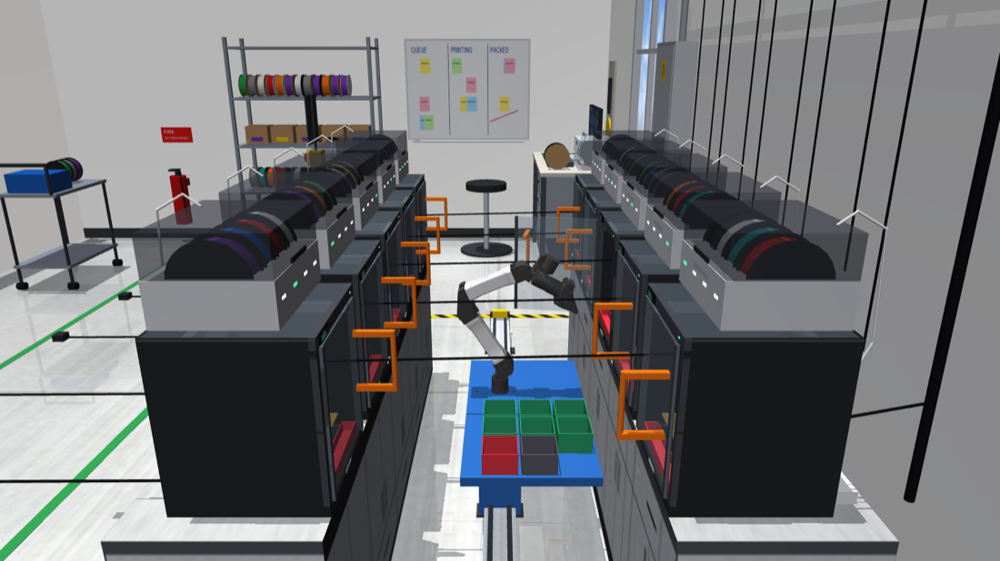
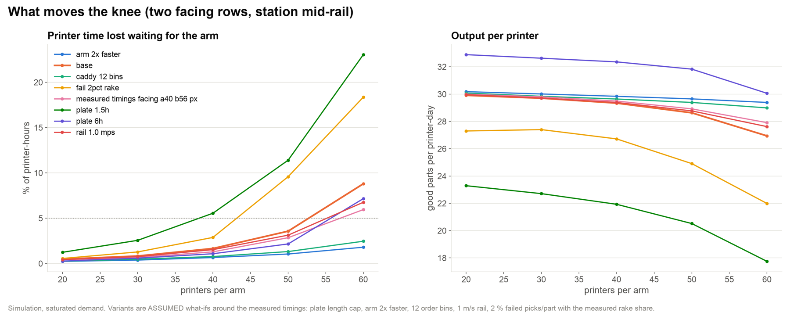
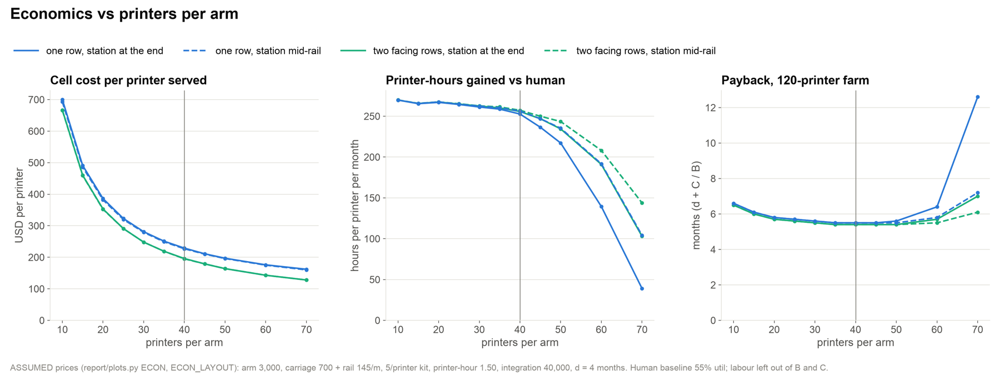

# Scaling the cell: printers per arm and a second row

> **Adopted:** the default scene is now two facing rows of 10 printers (`PRINTFARM_LAYOUT=two_rows`, aisle 0.40 m, caddy
> beside the arm). 20 printers sits well below the knee below, leaving the arm headroom (busy about a quarter of the
> week) for failures, slower parts or growth toward the 40-printer recommendation.

Today's cell is one row of 10 printers along a wall, served by one YAM arm on a rail. The fleet model says the arm
is busy only about 14 % of the week, so two questions follow: how many printers can one arm serve, and does a
second row of printers facing the first (rail in the middle) work mechanically and pay off?

**Recommendation: two facing rows, 20 printers each side, the bin hand-off station mid-rail, the rail 0.40 m from
each row's doors (today 0.28 m), and the caddy beside the arm instead of behind it.**

- **40 printers per arm.** One arm serves about 50 printers before the printers start losing time waiting for it
  (the knee). At 40 the printers lose 1.7 % of their hours to waiting, the arm is busy 64 % of the week under
  saturated demand, and the cell makes 1,174 parts a day, 3.9 x today's 10-printer cell, at the same lead time
  (p90 6.5 h at today's demand per printer). The 36 % of spare arm time absorbs failed picks and slower real
  hardware: with 2 % failed picks per part the knee moves from 50 to 40 printers (section 3).
- **Two facing rows with a mid-rail station** is the best of the four layouts tried. Up to 40 printers all four
  make the same output; the facing rows need half the rail (10.1 m instead of 19.3 m at 40 printers), a third of
  the rail travel, and degrade most gently past the knee (at 60 printers: 8.8 % waiting vs 18.8 % for one long row
  with the station at the end).
- **It works mechanically only in a narrow window.** With the rail 0.28 m or 0.34 m from the doors, the arm's elbow
  hits the opposite printer's door handle; at 0.37 m the doors open but do not close; at 0.43 m the back of the bed
  is out of reach. At **0.40 m** both rows' doors open and close in one swing, the whole bed is reachable and all 8
  bins are reachable from both rows. Full unload episodes on the two-row model: **148/148 parts placed, doors 28/28
  opened and 28/28 closed, on both rows**.
- **Economics (assumed prices):** the cell hardware per printer served drops from about USD 666 at 10 printers to
  195 at 40 (one row of 40: 229, because of the longer rail), and at 40 printers it is repaid by recovered
  printer-hours in about half a month. For a 120-printer farm the payback including the one-off integration and 4
  months to deploy is about 5.4 months at 40 printers per arm against 6.6 months with today's 10-printer cells: deployment
  time and integration dominate, so the layout choice is mostly about hardware per printer, floor space (about a
  third less per printer with two rows) and rail length.

Every number below comes from a script in this repository; the commands are at the end. The fleet results are
simulations with measured robot timings (`runs/timings.json`, from the MuJoCo unload batch) and **assumed** order
rates, print times and operator behaviour (`fleet/des.py`, `jobs/orders.py`). Money figures are assumptions, not
quotes.



## 1. How many printers can one arm serve?

`fleet/des.py` now takes a layout: printer positions along the rail and the position of the bin hand-off station
(`fleet.des.make_layout`). Four layouts, 10 to 70 printers per arm:

- **one row**: printers along a wall, rail in front (today's cell at 10 printers);
- **two facing rows**: half the printers on each side of the rail, so the rail is half as long;
- station **at the end** of the rail (today) or **mid-rail** (one row: across the aisle; two rows: the station
  takes one column of bench).

Two demand cases, both scaled with the number of printers N:

- **saturated**: 1.5 x today's orders per printer, more than the printers can print. This measures capacity.
  The knee is the largest N at which the printers lose at most 5 % of their hours waiting for the arm.
- **today's demand per printer**: the 10-printer order stream x N/10. This measures lead time. The knee is the
  largest N at which the order lead time p90 stays within 1.25 x the 10-printer value.

7 simulated days, 3 seeds each, `order_aware` dispatch, robot timings measured on the single-row cell.



Knee per layout (saturated demand: printers lose at most 5 % of their hours waiting for the arm; today's demand: lead time p90 within 1.25 x the 10-printer value):

| layout | knee, saturated demand (waiting for the arm <= 5 %) | knee, lead p90 <= 1.25 x | max parts/day per arm | at N |
|---|---:|---:|---:|---:|
| two facing rows, station mid-rail | 50 | 60 | 1687 | 70 |
| two facing rows, station at end | 50 | 60 | 1570 | 60 |
| one row, station mid-rail | 50 | 60 | 1572 | 60 |
| one row, station at end | 45 | 50 | 1432 | 60 |

Human baseline (10 printers, one operator 09-18 Mon-Fri): saturated util 55.23 %, 172.19 parts/day; today's demand: lead p50 24.62 h / p90 75.3 h.

Two facing rows, station mid-rail, by printers per arm (saturated demand unless noted):

| N | util % | waiting for arm % | arm busy % | parts/day | parts/printer-day | lead p50 h (today's demand) | lead p90 h | arm busy % (today's demand) | rail m | rail travel m/day | caddy-full events/wk |
|---|---:|---:|---:|---:|---:|---:|---:|---:|---:|---:|---:|
| 10 | 92.2 | 0.1 | 15.2 | 301 | 30.1 | 4.4 | 7.4 | 13.6 | 3.2 | 126 | 25 |
| 15 | 91.6 | 0.3 | 23.1 | 451 | 30.0 | 4.3 | 7.1 | 20.2 | 4.6 | 258 | 78 |
| 20 | 91.9 | 0.5 | 31.1 | 598 | 29.9 | 4.1 | 6.6 | 26.9 | 5.5 | 418 | 119 |
| 25 | 91.6 | 0.6 | 39.4 | 745 | 29.8 | 4.2 | 6.8 | 34.0 | 6.9 | 674 | 179 |
| 30 | 91.2 | 0.8 | 47.4 | 891 | 29.7 | 4.6 | 7.1 | 41.7 | 7.8 | 899 | 209 |
| 35 | 91.0 | 1.2 | 55.7 | 1033 | 29.5 | 4.4 | 6.8 | 48.8 | 9.2 | 1239 | 269 |
| 40 | 90.5 | 1.7 | 63.5 | 1174 | 29.3 | 4.3 | 6.5 | 56.7 | 10.1 | 1549 | 291 |
| 45 | 89.5 | 2.6 | 72.2 | 1305 | 29.0 | 4.6 | 6.7 | 63.7 | 11.5 | 2016 | 414 |
| 50 | 88.6 | 3.6 | 79.7 | 1432 | 28.6 | 4.8 | 7.4 | 71.8 | 12.4 | 2407 | 416 |
| 60 | 83.7 | 8.8 | 91.3 | 1617 | 26.9 | 5.0 | 7.8 | 84.9 | 14.7 | 3170 | 456 |
| 70 | 74.9 | 18.4 | 96.8 | 1687 | 24.1 | 8.5 | 12.2 | 95.3 | 17.0 | 3790 | 478 |

All four layouts:

| N | layout | util % | waiting for arm % | arm busy % | parts/day | lead p90 h (today's demand) | rail m | rail travel m/day |
|---|---:|---:|---:|---:|---:|---:|---:|---:|
| 20 | one row, station at end | 91.8 | 0.5 | 33.7 | 598 | 6.7 | 10.1 | 1330 |
| 20 | one row, station mid-rail | 91.9 | 0.5 | 31.9 | 598 | 6.6 | 9.6 | 707 |
| 20 | two facing rows, station at end | 91.9 | 0.5 | 32.1 | 598 | 6.6 | 5.5 | 753 |
| 20 | two facing rows, station mid-rail | 91.9 | 0.5 | 31.1 | 598 | 6.6 | 5.5 | 418 |
| 30 | one row, station at end | 91.0 | 1.0 | 53.2 | 888 | 7.1 | 14.7 | 2942 |
| 30 | one row, station mid-rail | 91.2 | 0.9 | 49.3 | 890 | 7.1 | 14.2 | 1590 |
| 30 | two facing rows, station at end | 91.2 | 0.8 | 49.4 | 890 | 7.1 | 7.8 | 1584 |
| 30 | two facing rows, station mid-rail | 91.2 | 0.8 | 47.4 | 891 | 7.1 | 7.8 | 899 |
| 40 | one row, station at end | 89.8 | 2.3 | 73.4 | 1166 | 6.7 | 19.3 | 5135 |
| 40 | one row, station mid-rail | 90.3 | 1.8 | 66.8 | 1172 | 6.6 | 18.8 | 2758 |
| 40 | two facing rows, station at end | 90.3 | 1.9 | 66.8 | 1171 | 6.6 | 10.1 | 2746 |
| 40 | two facing rows, station mid-rail | 90.5 | 1.7 | 63.5 | 1174 | 6.5 | 10.1 | 1549 |
| 50 | one row, station at end | 85.0 | 7.3 | 90.4 | 1372 | 8.3 | 23.9 | 7404 |
| 50 | one row, station mid-rail | 87.5 | 4.7 | 83.7 | 1412 | 7.5 | 23.4 | 4258 |
| 50 | two facing rows, station at end | 87.4 | 4.8 | 83.5 | 1412 | 7.5 | 12.4 | 4224 |
| 50 | two facing rows, station mid-rail | 88.6 | 3.6 | 79.7 | 1432 | 7.4 | 12.4 | 2407 |
| 60 | one row, station at end | 74.3 | 18.8 | 97.1 | 1432 | 12.3 | 28.5 | 8803 |
| 60 | one row, station mid-rail | 81.5 | 11.2 | 94.8 | 1572 | 9.0 | 28.0 | 5444 |
| 60 | two facing rows, station at end | 81.4 | 11.3 | 94.5 | 1570 | 8.5 | 14.7 | 5359 |
| 60 | two facing rows, station mid-rail | 83.7 | 8.8 | 91.3 | 1617 | 7.8 | 14.7 | 3170 |

What limits the arm: an unload costs about 3 minutes of arm time per plate (door open 20 s, purge tab 17 s,
about 5 parts x 23 s, door close 23 s, plus travel), against a printer cycle of about 3 h 15 min (a plate of up
to 3 h, 7.5 min of cooling, the unload). Below the knee the arm mostly waits for beds to cool; past it, beds wait
for the arm.
The caddy (6 order bins) fills mid-plate more often as the cell grows (the arm then closes the door, drives to the
station and comes back), which is why the station position matters more than the rail length: mid-rail halves
those trips.

## 2. Can the arm work two facing rows?



*The two-row test model (`python scripts/layout_geometry.py render --layout facing_a40_b56_px`), 5 printers per
row. The room dressing (`farm/lab.py`) still assumes one row; the cables crossing the aisle are part of it.*

Geometry is checked with the real planners (`plan.door.plan_door`, `plan.unload.plan_grasp`,
`plan.unload.drop_pose`, `plan.door.slide_free`) on a MuJoCo model built from patched layout constants
(`scripts/layout_geometry.py`; `farm/catalog.py` and `farm/scene.py` are not edited). The test model has 3 printers
per row; the checked printers are the middle ones, with neighbours on both sides and a row opposite. Bed grasp
coverage uses a 4 x 4 grid over the bed with a cube and a narrow clip as probes, door open.

**Why the earlier attempt failed.** With the rail 0.28 m from the doors (today's value) or 0.34 m, the door plans
fail on both rows. Logging the collisions during the door search (aisle 0.34 m) shows the forearm (`link_3`)
hitting the **opposite row's D-handles**, which stand 0.11 m off the glass into the aisle (154 of 181 logged
contacts), and the opposite door's glass (24). Raising or lowering the arm base (0.50 / 0.56 / 0.62 m) does not
help. At 0.37 m the doors open but do not close. At 0.40 m both rows open and close in one continuous swing; at
0.43 m the back row of the bed grid (y = 236 mm) is out of reach.

**Caddy.** Behind the arm (today: y = -0.27 to -0.39 m) is where the second row sits, and the deck must stay
inside the aisle (the benches are solid from the floor to 0.72 m and the deck is at 0.53-0.56 m). What had to
change, each found by a failing check:

1. A point-symmetric caddy (2 x 2 bins on each side of the arm) loses one bin: the YAM's base joint covers -150 to
   +175 deg, and bins straight behind the arm (-x) sit in its dead zone. All 8 bins go to the **+x side** in a
   3 x 3 grid (one corner free), y = 0 to 0.24 m.
2. The first full episodes on that layout opened the door but could not close it in 5 of 6 plates. Logging the
   failed door search showed the arm base "hitting" a part in the nearest bin. That is a planning-model artifact:
   `IK.collides` tries carriage positions other than the current one, but parts already in the bins stay at their
   world position in the planning model, so to the planner the arm base drives into them. Behind the arm that
   never happens; beside the arm it blocks door and transfer plans. `scripts/layout_geometry.py` lets them ride
   with the carriage, as they do physically (integration note for `plan/ik.py` in section 5).
3. The same episodes could not park the arm after the door ("could not park"): the folded pose used to slide
   along the rail (`plan.door.LOW_TUCK`) hangs the forearm down past the deck's -x edge, and the first two-row deck
   extended to -0.51 m. The deck keeps today's -x edge (-0.27 m) and grows only toward +x (to +0.57 m).
4. The nearest bin column moved from 0.20 m to 0.26 m from the arm base, so that parts in it keep clear of the
   base's planning margin (a precaution; its effect was not isolated from 2 and 3).

Sweep results (middle printer of row A, and of row B when there are two rows; `side` = point-symmetric 2 x 2 blocks, `plusx` = all bins on the +x side, `behind` = today):

| rows | aisle m | arm base z m | caddy | door A open/close | door B open/close | bed grasp coverage (16 pts x 2 probes) | bins reachable A | bins reachable B | deck-bench gap m |
|---|---:|---:|---:|---:|---:|---:|---:|---:|---:|
| 1 | 0.28 | 0.56 | behind | yes / yes | - | 100 % | 8/8 | - | 0.13 |
| 2 | 0.28 | 0.50 | side | NO / NO | NO / NO | 100 % | 7/8 | - | 0.04 |
| 2 | 0.28 | 0.56 | side | NO / NO | NO / NO | 100 % | 7/8 | - | 0.04 |
| 2 | 0.28 | 0.62 | side | NO / NO | NO / NO | 100 % | 7/8 | - | 0.04 |
| 2 | 0.34 | 0.50 | side | NO / NO | NO / NO | 100 % | 7/8 | - | 0.09 |
| 2 | 0.34 | 0.56 | side | NO / NO | NO / NO | 100 % | 7/8 | - | 0.09 |
| 2 | 0.34 | 0.62 | side | NO / NO | NO / NO | 100 % | 7/8 | - | 0.09 |
| 2 | 0.37 | 0.56 | plusx | yes / NO | yes / NO | 100 % | 8/8 | 8/8 | 0.06 |
| 2 | 0.37 | 0.56 | side | yes / NO | yes / NO | 100 % | 7/8 | 7/8 | 0.12 |
| 2 | 0.40 | 0.50 | side | yes / yes | yes / yes | 75 % | 7/8 | - | 0.15 |
| 2 | 0.40 | 0.56 | plusx | yes / yes | yes / yes | 100 % | 8/8 | 8/8 | 0.09 |
| 2 | 0.40 | 0.56 | side | yes / yes | yes / yes | 100 % | 7/8 | - | 0.15 |
| 2 | 0.40 | 0.62 | plusx | yes / yes | yes / yes | 100 % | 8/8 | 8/8 | 0.09 |
| 2 | 0.40 | 0.62 | side | yes / yes | yes / NO | 100 % | 7/8 | - | 0.15 |
| 2 | 0.43 | 0.56 | plusx | yes / yes | yes / yes | 75 % | 8/8 | 8/8 | 0.12 |

**Full unload episodes** on the recommended geometry (`facing_a40_b56_px`): the batch evaluator's episode
(`scripts/eval_unload.py`: door open, chamber-camera perception, grasp planning, picks into the caddy, rake
fallback, door close) on the middle printer of row A and of row B, 14 plates each, the same seeds as the
single-row batch.

| printer | parts | placed | door ok | open s | close s | s per pick | other outcomes |
|---|---:|---:|---:|---:|---:|---:|---:|
| p1 | 74 | 100.0 % | 1.00 | 21.3 | 20.1 | 16.4 | - |
| p4 | 74 | 100.0 % | 1.00 | 24.5 | 21.3 | 20.1 | - |
| both rows | 148 | 100.0 % | 1.00 | 22.9 | 20.7 | 18.2 | - |
| one row, same seeds | 74 | 100.0 % | 1.00 | 20.3 | 23.4 | 23.0 | - |

Picks are faster than in the single-row cell (18.2 s vs 23.0 s per part on the same plates): the bins sit about
90 deg from the printer instead of 180 deg behind the arm, so the base joint turns about half as far per pick
(this would also speed up today's single row, if its caddy moved beside the arm; not tested). Row B is slower
than row A (20.1 s vs 16.4 s): the bins sit on row A's side of the rail axis (y = 0 to 0.24 m), so the base turns
further for row B. The DES variant `measured_timings_facing_a40_b56_px` in section 3 uses these numbers.

## 3. What moves the knee

Two facing rows, station mid-rail, saturated demand. Each variant changes one assumption around the measured
baseline (`base`: single-row timings); `measured_timings_facing_a40_b56_px` uses the timings measured on the
two-row model above.



Printer time waiting for the arm (%) / good parts per day, and the knee:

| variant | N=20 | N=30 | N=40 | N=50 | N=60 | knee N |
|---|---:|---:|---:|---:|---:|---:|
| arm_2x_faster | 0.2 / 604 | 0.4 / 900 | 0.7 / 1194 | 1.1 / 1483 | 1.8 / 1764 | 60 |
| base | 0.5 / 598 | 0.8 / 891 | 1.7 / 1174 | 3.6 / 1432 | 8.8 / 1617 | 50 |
| caddy_12_bins | 0.3 / 602 | 0.5 / 895 | 0.8 / 1186 | 1.3 / 1470 | 2.5 / 1740 | 60 |
| fail_2pct_rake | 0.6 / 546 | 1.3 / 822 | 2.9 / 1069 | 9.6 / 1246 | 18.4 / 1319 | 40 |
| measured_timings_facing_a40_b56_px | 0.4 / 600 | 0.7 / 894 | 1.3 / 1180 | 2.9 / 1446 | 6.0 / 1675 | 50 |
| plate_1.5h | 1.2 / 466 | 2.6 / 681 | 5.5 / 877 | 11.4 / 1026 | 23.1 / 1065 | 30 |
| plate_6h | 0.3 / 658 | 0.6 / 979 | 1.1 / 1294 | 2.2 / 1591 | 7.2 / 1804 | 50 |
| rail_1.0_mps | 0.4 / 599 | 0.8 / 891 | 1.5 / 1176 | 3.1 / 1438 | 6.8 / 1657 | 50 |

- **Plate length is the biggest lever.** The arm's work is per plate, so 1.5 h plates roughly double its load and the knee
  drops to 30 printers; 6 h plates keep the knee at 50 but raise output per printer. Shops that print short jobs
  need fewer printers per arm.
- **A bigger caddy is the cheapest hardware lever:** 12 order bins instead of 6 cut the mid-plate station trips and
  move the knee to 60. A 2x faster arm does the same.
- **Failed picks cost arm time** (a person comes, or the arm rakes and the part is reprinted): with 2 % failed
  picks per part the knee moves to 40. That is the reason for recommending 40, not 50.
- Rail speed barely matters (1.0 m/s vs 0.4 m/s), and the two-row timings measured above are slightly faster than
  the single-row ones, so the knee holds at 50.

**Failed picks.** `scripts/des_sensitivity.py` for the recommended cell (40 printers, two facing rows, station
mid-rail), with and without the rake fallback (the share of failed parts the rake clears off the bed is measured
on the fault batch). The human baseline runs one operator per 10 printers.

| failed picks / part | rake | util % | parts/printer-day | lead p90 h | printer-h blocked/wk |
|---|---:|---:|---:|---:|---:|
| human, 10 printers | - | 48.1 | 14.63 | 75.3 | 0.0 |
| 0 % | no | 78.4 | 24.88 | 6.5 | 0.0 |
| 0 % | yes | 78.4 | 24.88 | 6.5 | 0.0 |
| 1 % | no | 72.7 | 23.09 | 14.1 | 791.1 |
| 1 % | yes | 77.6 | 24.48 | 7.4 | 202.9 |
| 2 % | no | 66.3 | 21.19 | 32.5 | 1432.5 |
| 2 % | yes | 76.9 | 24.07 | 8.9 | 383.5 |
| 5 % | no | 50.7 | 16.18 | 79.1 | 2477.9 |
| 5 % | yes | 73.5 | 22.53 | 20.0 | 882.8 |
| 10 % | no | 34.8 | 11.00 | 143.2 | 3335.4 |
| 10 % | yes | 65.1 | 19.16 | 51.2 | 1546.3 |
| 20 % | no | 21.1 | 6.55 | 192.2 | 4014.6 |
| 20 % | yes | 52.9 | 14.23 | 106.1 | 2248.1 |

The picture is the same as for today's 10-printer cell: with the rake, the 40-printer cell still beats the human
baseline at 20 % failed picks (52.9 % vs 48.1 % utilisation); without it, it falls to the human level near 5 %
(50.7 %). Stuck parts block their own printer until the next shift no matter how many printers share the arm.

## 4. Economics

`report/plots.py` splits the cell cost so that it scales with the layout: arm, carriage, rail per metre, caddy,
camera + compute, station, setup, and a small per-printer kit (door handle, reject tray). The benefit is the
printer-hours gained over the human baseline under saturated demand (one operator per 10 printers, hourly checks,
Mon-Fri 09-18), valued at an assumed contribution margin per printer-hour. Labour saved is left out of both sides,
as in the 10-printer economics (`runs/plots/economics.png`).



Today's arrangement (one row, station at the end) and the recommended one; all four layouts are in `runs/layout/layout_economics.json`:

| layout | N | rail m | cell cost USD | per printer USD | extra printer-h / printer-month | B USD / cell-month | cell payback months (C/B) | 120-printer farm payback months |
|---|---:|---:|---:|---:|---:|---:|---:|---:|
| two facing rows, station mid-rail | 10 | 3.2 | 6,664 | 666 | 269.9 | 3,998 | 1.7 | 6.5 |
| two facing rows, station mid-rail | 20 | 5.5 | 7,048 | 352 | 267.5 | 7,974 | 0.9 | 5.7 |
| two facing rows, station mid-rail | 30 | 7.8 | 7,431 | 248 | 262.7 | 11,773 | 0.6 | 5.5 |
| two facing rows, station mid-rail | 40 | 10.1 | 7,814 | 195 | 257.3 | 15,385 | 0.5 | 5.4 |
| two facing rows, station mid-rail | 50 | 12.4 | 8,198 | 164 | 243.5 | 18,209 | 0.5 | 5.4 |
| two facing rows, station mid-rail | 60 | 14.7 | 8,582 | 143 | 208.1 | 18,681 | 0.5 | 5.5 |
| one row, station at end | 10 | 5.5 | 7,003 | 700 | 269.8 | 3,997 | 1.8 | 6.6 |
| one row, station at end | 20 | 10.1 | 7,720 | 386 | 267.0 | 7,961 | 1.0 | 5.8 |
| one row, station at end | 30 | 14.7 | 8,437 | 281 | 261.3 | 11,707 | 0.7 | 5.6 |
| one row, station at end | 40 | 19.3 | 9,154 | 229 | 252.7 | 15,114 | 0.6 | 5.5 |
| one row, station at end | 50 | 23.9 | 9,871 | 197 | 217.2 | 16,238 | 0.6 | 5.6 |
| one row, station at end | 60 | 28.5 | 10,588 | 176 | 139.4 | 12,499 | 0.8 | 6.4 |

## 5. Changes needed to adopt two rows

Adopted: these changes are now in the code (`PRINTFARM_LAYOUT=two_rows`, the default, with 2 x 10 printers). The
table below records what was changed relative to the one-row cell:

| File | Change |
|---|---|
| `farm/catalog.py` | `N_ROWS, N_PER_ROW = 2, 20`; `AISLE_HALF = 0.40`; `CADDY_SLOTS` = the +x grid: `o2 (0.26, 0.00)`, `o3 (0.26, 0.12)`, `o0 (0.26, 0.24)`, `o5 (0.38, 0.00)`, `o1 (0.38, 0.12)`, `o4 (0.38, 0.24)`, `reject (0.50, 0.00)`, `waste (0.50, 0.12)`; `BASE_Z = DECK_Z = 0.56` (unchanged) |
| `farm/scene.py` | `_carriage()`: for two rows, deck x from -0.27 to +0.57 m and y from -0.12 to +0.31 m around the arm base (inside the aisle); `_carriage_two_rows` in `scripts/layout_geometry.py` is the drop-in version. Station: mid-rail needs one column of bench left free |
| `plan/ik.py` | `IK.sync` / `IK.collides`: parts resting in the caddy move with the carriage when a plan tries another rail position (as `_patch_ik_carry_caddy` in `scripts/layout_geometry.py`) |
| `sim/farm.py` | two single-row assumptions: the scheduler candidate position `printer_frame(i)[0] + 0.15` and the drive target `xc + 0.35` must use the row's side: `xc + s * 0.15`, `xc + s * 0.35`; a mid-rail station also moves `C.STATION_X` (and the station geometry in `farm/scene.py`) |
| `farm/lab.py` | the room dressing assumes one row (back wall at `AISLE_HALF + 0.64` behind row A); visual only |

Everything else (`plan/door.py`, `plan/unload.py`, `plan/sweep.py`, `perceive/`) already handles row B through
`printer_frame`'s side; the row-B episodes above confirm it.

## Limits

- The fleet model is a discrete-event simulation: order rates, print times (a 3 h plate cap), cooling and the
  operator are assumptions. The robot durations and success rates are measured, on the single-row batch (section
  1) and on the two-row episodes (section 3, variant `measured_timings_facing_a40_b56_px`).
- Filament changes, maintenance and emptying reject trays are not modelled; they scale with the number of
  printers, not with the layout.
- The geometry window is narrow: 0.37 m fails, 0.40 m works, 0.43 m loses the back of the bed. The sweep step was
  3 cm, so the exact margins around 0.40 m were not measured; a real build should check them. A flush or recessed
  handle on the opposite row would widen the window; not tested.
- Floor space and rail are computed from the geometry; only the rail is priced. Per printer, the two-row cell needs
  about 0.41 m2 of floor (benches 0.5 m deep, aisle 0.80 m, pitch 0.46 m) against about 0.62 m2 for one row
  (bench 0.5 m plus 0.84 m from the door plane to behind the carriage).
- The two-row episodes are 28 plates without injected faults; the fault behaviour (rake, reject tray) was not
  re-run on two rows.

## Reproduce

```bash
export PYTHONPATH=.
python scripts/layout_study.py --procs 2                                  # DES sweep -> runs/layout/des_study.json
python scripts/layout_geometry.py sweep --procs 2                         # geometry, all layouts -> geometry.jsonl
python scripts/layout_geometry.py episodes --layout facing_a40_b56_px --printers 1 4 \
    --seeds 0 1 2 3 4 5 6 7 8 9 10 11 12 13 --procs 2                     # full unloads on both rows
python scripts/layout_geometry.py summary --layout facing_a40_b56_px \
    --baseline runs/eval                                                  # vs the single-row batch, same seeds
python scripts/layout_geometry.py render --layout facing_a40_b56_px       # stills of the two-row model
python scripts/layout_study.py --sens --layout facing --station center --procs 2 \
    --timings runs/layout/timings_facing_a40_b56_px.json                  # what-ifs -> runs/layout/des_sens.json
python scripts/des_sensitivity.py runs/eval_faults --layout facing --station center --n-printers 40
python -m report.plots --layout runs/layout --out runs/layout --mark 40   # layout_*.png, layout_economics.json
python scripts/layout_figure.py                                           # layout_plan.png
python scripts/layout_tables.py --n 40 > runs/layout/tables.md            # the tables on this page
```
